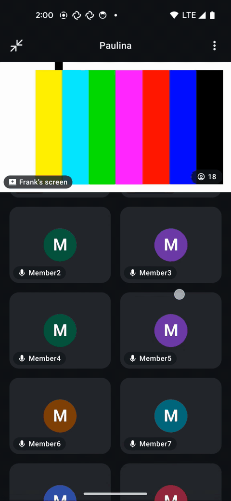

# Element Call Android

A native [MatrixRTC](https://github.com/matrix-org/matrix-spec-proposals/blob/main/proposals/4143-matrix-rtc.md)
call implementation for android: media, session, user interface and the Matrix side, built on
[matrix-rust-rtc](https://github.com/element-hq/matrix-rust-rtc).

<p align="center">
  
</p>


**Status: release candidates.** Versions are `0.x` and every one of them may change the API; releases are published
to Maven Central, see [Consuming a release](#consuming-a-release).

<!--- TOC -->

* [Modules](#modules)
* [Consuming a release](#consuming-a-release)
* [Building](#building)
* [The sample app](#the-sample-app)
* [Host requirements](#host-requirements)
* [Documentation](#documentation)
* [Copyright & License](#copyright-license)

<!--- END -->

## Modules

Four published artifacts under `io.element.android`, one version, plus `element-call-bom` to pin them together:

| Artifact | Project | What it is |
| :--- | :--- | :--- |
| `element-call-api` | `call/api` | the contract: controller, ports, state types, options |
| `element-call` | `call/impl` | the stack, the controller, the foreground service, the Rust core wrapper; no Compose |
| `element-call-ui` | `call/ui` | the call screen (`ElementCallActivity`), the minimized bar, picture-in-picture, style port |
| `element-call-test` | `call/test` | fakes and fixtures for hosts' tests, and the colour-bar test pattern |
| not published | `sample` | the harness: a Compose app over the fakes, a host Activity and the instrumented tests |

See [AGENTS.md](AGENTS.md) for the boundaries between them.

## Consuming a release

The artifacts are on Maven Central, and so is the `matrix-rust-rtc` core they depend on,
`io.element.android:matrix-rtc-android`. With `mavenCentral()` among the repositories, through the BOM so one
version pins the four:

```kotlin
implementation(platform("io.element.android:element-call-bom:<version>"))
implementation("io.element.android:element-call-ui")
implementation("io.element.android:element-call")
testImplementation("io.element.android:element-call-test")
```

The core's version is fixed by the library's metadata; a host never names it. An unreleased build is consumed
from the local Maven repository instead ([docs/local_stack.md](docs/local_stack.md), layer 3).

**From a GitHub release instead.** Each [release](https://github.com/element-hq/element-call-android/releases) also
carries the artifacts as assets, with their module metadata, POMs and sources, and a `SHA256SUMS`, so that a build
can resolve them straight from the release, a fork's included. The core still comes from Maven Central:

```kotlin
dependencyResolutionManagement {
    repositories {
        ivy {
            url = uri("https://github.com/element-hq/element-call-android/releases/download")
            patternLayout { artifact("v[revision]/[artifact]-[revision](-[classifier]).[ext]") }
            metadataSources { gradleMetadata() }
            content {
                includeModule("io.element.android", "element-call-bom")
                includeModule("io.element.android", "element-call-api")
                includeModule("io.element.android", "element-call")
                includeModule("io.element.android", "element-call-ui")
                includeModule("io.element.android", "element-call-test")
            }
        }
        google()
        mavenCentral()
    }
}
```

## Building

```
./gradlew assemble test runQualityChecks
```

The `matrix-rust-rtc` core comes from Maven Central, at the version in `gradle/libs.versions.toml`.
[docs/local_stack.md](docs/local_stack.md) explains how to build against a local core, and how to work on the core,
this library and Element X at once.

## The sample app

`sample/` is how the UI is developed without Element X: a Compose app over the fakes, with no server, no login and
no camera. Every row of its picker opens a call - one to one, a group with a spotlight, nine people with a paging
strip, a shared screen, the minimized bar, and the connecting, failed and permission states - with colour bars where
a camera would be, drawn through the real renderer. Its controls do what they say (mute mutes, minimize minimizes,
into picture-in-picture for a video call), a switch overrides the style with a deliberately loud one, and "Answer on
the lock screen" opens a call over the keyguard five seconds later, through a full-screen notification.

```
./gradlew :sample:installDebug
adb shell am start -n io.element.android.call.sample/.SampleActivity --es fixture group   # or any SampleFixture key
./gradlew :sample:connectedDebugAndroidTest                                                # the gesture and pixel tests
```

## Host requirements

Numbered so an integration can be checked against them. Items marked *pending* are settled when the corresponding
code lands.

1. `minSdk` 24 or higher.
2. ABIs `armeabi-v7a`, `arm64-v8a`, `x86_64`. There is no `x86` build of the core; a host that ships `x86` must
   exclude it or accept that the call is unavailable there.
3. A `MatrixBackend` over the host's own Matrix client, handed to `ElementCallStack.Builder`. The sample's
   `SdkMatrixBackend` is one over the Rust SDK ([docs/INTEGRATION.md](docs/INTEGRATION.md), §3).
4. The call screen is the library's `ElementCallActivity`, on top of the host's Activity. It is shown over the lock
   screen while a call is live, so a call answered on a locked phone never shows the host's Activity. The host:
   - implements `ElementCallActivity.Host` on its `Application`: the controller; `leaveCallScreenIntent`, the
     Activity the call screen leaves for; `onCallActivityCreated`, which calls
     `ElementCallPictureInPicture.attach(activity, controller)` and applies anything every Activity of the host
     gets, such as `FLAG_SECURE`; and `CallScreenContent`, for the style;
   - wraps its content in `ElementCallOverlay`, which draws the minimized bar and opens the call screen whenever the
     call is maximized while the host is in front;
   - calls `ElementCallActivity.start(context)` where nothing of the host is in front (answering from a ringing
     screen), and sets `ElementCallNotificationConfig.contentIntent` to `ElementCallActivity::pendingIntent`.

   Minimizing asks the keyguard first. A video call then shrinks into picture-in-picture over the host's Activity;
   an audio call, or one refused picture-in-picture, leaves for the host's Activity with the bar. The host's own
   app lock applies at that Activity, never to a live call. The host Activity needs no picture-in-picture
   attribute.
5. Screen sharing is off by default. A host turns it on with `ElementCallOptions(isScreenSharingEnabled = true)`
   and, in the same change, adds `FOREGROUND_SERVICE_MEDIA_PROJECTION` and the `mediaProjection` type to
   `ElementCallForegroundService` in its own manifest, with `tools:node="merge"`; the library's service declares
   only `microphone|camera`. That type is Play-reviewed, so the library does not declare it, and without it the
   first share is a `SecurityException` on Android 14+.
   `ElementCallOptions(isSfuFallbackEnabled = true)`, also off, lets a call whose own media server is down borrow another
   member's; turn it on only where those servers accept users from other homeservers.
6. Optional, and worth it if the host's client can tell: `controller.reportConnectivity(isOnline)`, `false` when its
   Matrix client goes offline and `true` once a request has succeeded again, not when sync merely starts. The call then
   says "your server is unreachable" at once and retries its sends the moment the server is back; without it, it
   notices at its next send.

## Documentation

- [AGENTS.md](AGENTS.md): boundaries, commands, conventions.
- [docs/local_stack.md](docs/local_stack.md): the local development stack.
- [docs/screenshot_testing.md](docs/screenshot_testing.md): the Paparazzi screenshot tests.
- [RELEASING.md](RELEASING.md): versioning, cutting a release, and what must never be published.
- [CHANGES.md](CHANGES.md): the changelog.
- [CONTRIBUTING.md](CONTRIBUTING.md): how to submit a change.

## Copyright & License

Copyright (c) 2026 Element Creations Ltd.

This software is dual licensed by Element Creations Ltd (Element). It can be used either:

(1) for free under the terms of the GNU Affero General Public License (as published by the Free
Software Foundation, either version 3 of the License, or (at your option) any later version); OR

(2) under the terms of a paid-for Element Commercial License agreement between you and Element (the
terms of which may vary depending on what you and Element have agreed to).

Unless required by applicable law or agreed to in writing, software distributed under the Licenses is
distributed on an "AS IS" BASIS, WITHOUT WARRANTIES OR CONDITIONS OF ANY KIND, either express or
implied. See the Licenses for the specific language governing permissions and limitations under the
Licenses.
